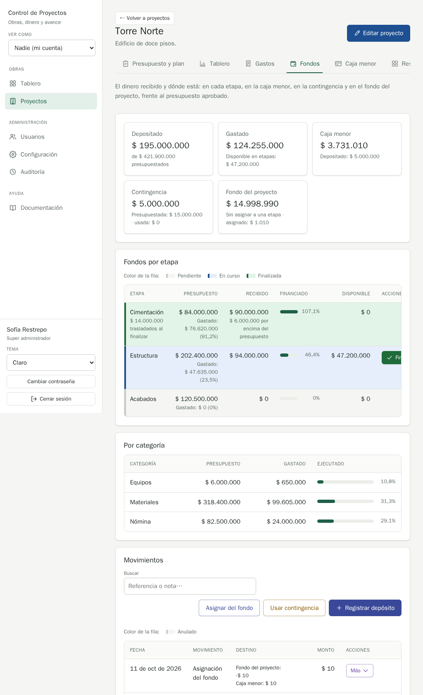

# QA-0018 · Between 601 and about 1200 px the stage table is wider than its card and Finalizar etapa is cut off

## Summary

On a tablet or small laptop (601 px to roughly 1200 px wide), the "Fondos por etapa" table is wider than its card, so it scrolls sideways inside the card: the "Acciones" header is clipped and an in-progress stage's "Finalizar etapa" button is cut off at the card's edge, with no sign that the table scrolls. "Movimientos" does the same around 900 px.

## Steps to reproduce

Account: admin@demo.test · Data: `make seed` · Width: 1024 (also 768 and 900) · Theme: light

1. Open Torre Norte › Fondos at 1024 × 1000, loading the page at that width.
2. Look at the Estructura row (En curso) of "Fondos por etapa".

## Expected

The row's main action is visible without scrolling, as on the desktop (1280+) and on the phone (≤ 600 px, where tables become cards since QA-0001). House style: everything clickable is in the last column, "Acciones", in view (`docs/qa/README.md` design sources; reference screen Proyectos).

## Actual

The table is 764 px wide in a 671 px card at 1024 px (692 px at 768, 554 at 900). "Finalizar etapa" ends at x = 1051 while the card ends at 993; only "Fi" is visible and "ACCIONE" is clipped. At 900 px, Movimientos is 649 px wide in a 554 px card.

## Evidence

Measured in the browser (table width / visible width / button right edge / card right edge): 768 → 764 / 692 / 788 / 752 · 900 → 764 / 554 / 1047 / 873 · 1024 → 764 / 671 / 1051 / 993 · 1280 → 911 / 911 / 1206 / 1242 (fine).

## Suspected cause

The card layout for tables only starts at `@media (max-width: 600px)` (`backend/assets/styles/app.css:914`). Above that, the stage table's unwrapped money cells, the 96 px progress bar (`app.css:2147`) and the unwrapped button add up to more than the card. Not introduced by the project-fund work: the stage table's columns did not change. Other tabs' tables were not measured in this run.

## History

- 2026-10-11 · found in run 2026-10-11-project-fund at 6ee1ac0
