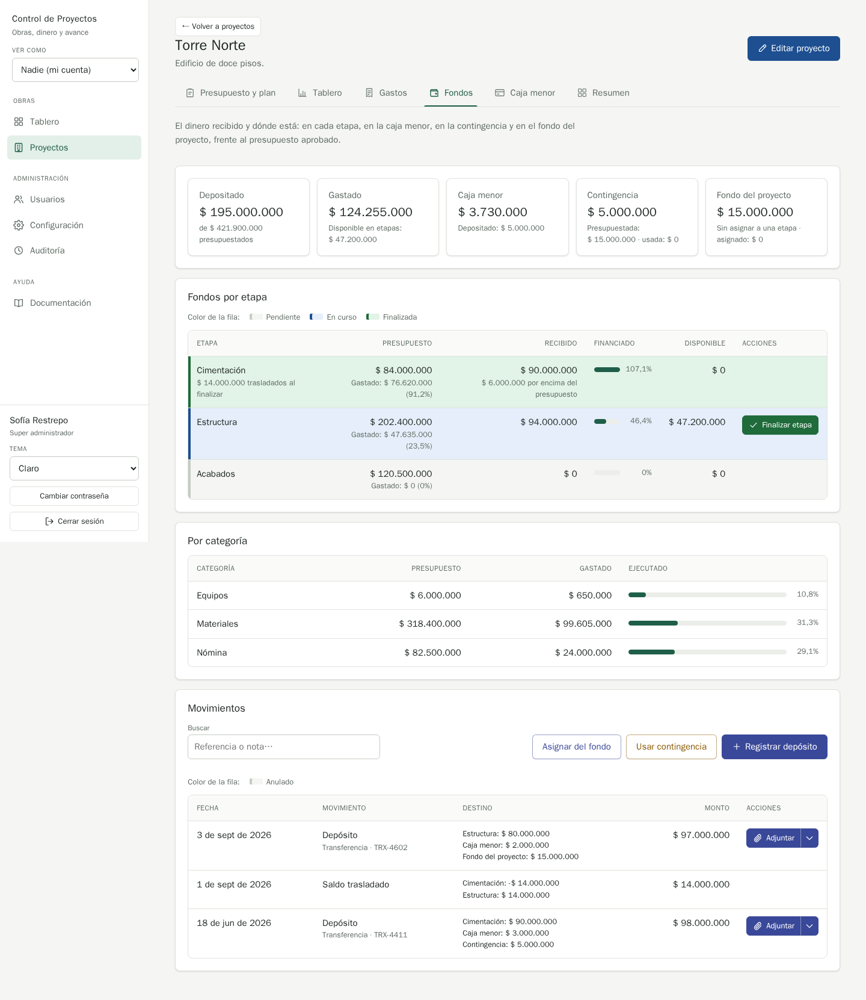

# QA-0019 · The Fondo del proyecto tile's detail line breaks the label: value pattern of its sibling tiles

## Summary

The stat tiles on Fondos explain their figure with "Label: value" lines ("Depositado: $ X", "Presupuestada: $ X · usada: $ Y"), but the new "Fondo del proyecto" tile reads "Sin asignar a una etapa · asignado: $ X": a description followed by a lower-case label, a different pattern from its neighbours.

## Steps to reproduce

Account: admin@demo.test · Data: `make seed` · Width: 1440 · Theme: light

1. Open Torre Norte › Fondos.
2. Read the small line under each of the five tiles.

## Expected

The same shape as the sibling tiles, e.g. "Depositado: $ X · asignado: $ Y" (the Contingencia tile: "Presupuestada: $ X · usada: $ Y"). The tile's meaning ("money without a stage") already lives in the tab intro and the help topic.

## Actual

"Sin asignar a una etapa · asignado: $ 0".

## Evidence

Tiles as read by the browser: `Caja menor · Depositado: $ 5.000.000`, `Contingencia · Presupuestada: $ 15.000.000 · usada: $ 0`, `Fondo del proyecto · Sin asignar a una etapa · asignado: $ 0`.

## Suspected cause

`finance.projectFundDetail` in `backend/assets/react/shared/i18n/es.ts`.

## History

- 2026-10-11 · found in run 2026-10-11-project-fund at 6ee1ac0
