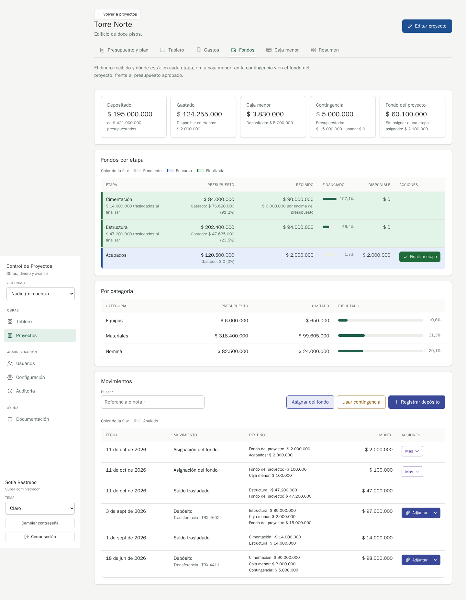
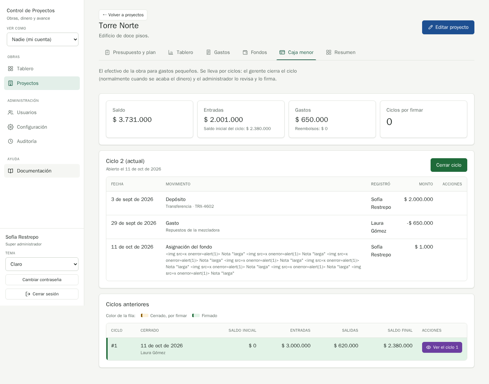

# QA-0020 · The Caja menor tile says Depositado and leaves out fund assignments, while the Caja menor tab counts them as Entradas

## Summary

Since money can reach the caja menor from the project fund, the Fondos tab's "Caja menor" tile explains its balance with "Depositado: $ X", which counts deposits only, while the Caja menor tab counts the same fund assignment under "Entradas". The tile's line no longer adds up to its balance, and the two tabs name the same inflow differently.

## Steps to reproduce

Account: admin@demo.test · Data: `make seed` · Width: 1440 · Theme: light

1. Torre Norte › Fondos: note the Caja menor tile ($ 3.730.000, "Depositado: $ 5.000.000").
2. Asignar del fondo › Destino Caja menor, Monto `100.000` › Asignar.
3. The tile shows $ 3.830.000 and still "Depositado: $ 5.000.000".
4. Open Caja menor: Entradas grew by $ 100.000 and the cycle lists "Asignación del fondo".

## Expected

The tile counts everything that came into the caja menor, the way a stage's "Recibido" counts deposits, draws, fund assignments and carry-overs (`StageFundingOutput.received`), and uses the same word as the Caja menor tab ("Entradas") or the stages ("Recibido").

## Actual

"Depositado" leaves out fund assignments; the Caja menor tab calls them "Entradas".

## Evidence

## Suspected cause

`FinancePresenter::summary()` builds `PettyCashSummaryOutput` from `$b->in($pc, MovementType::Deposit)` only (`backend/src/Finance/UI/Http/Presenter/FinancePresenter.php`), and the tile reads `finance.pettyCashDetail` ("Depositado: {{deposited}}").

## History

- 2026-10-11 · found in run 2026-10-11-project-fund at 6ee1ac0
- 2026-10-11 · fixed in 7e584a7 on feature/qa-fixes-and-docs; re-checked: FinanceBoard.test.tsx and FinanceApiTest (pettyCash.received counts fund assignments)
